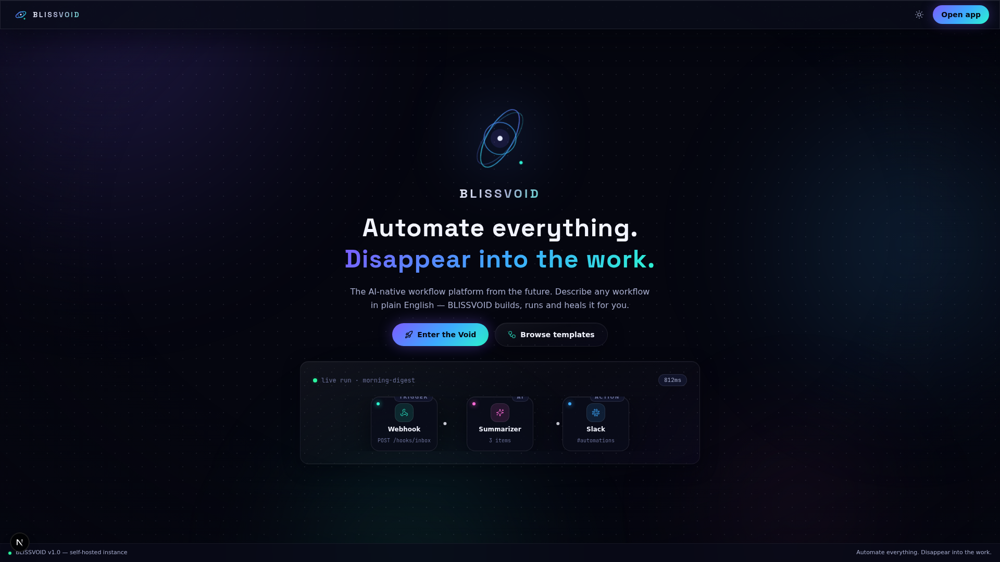
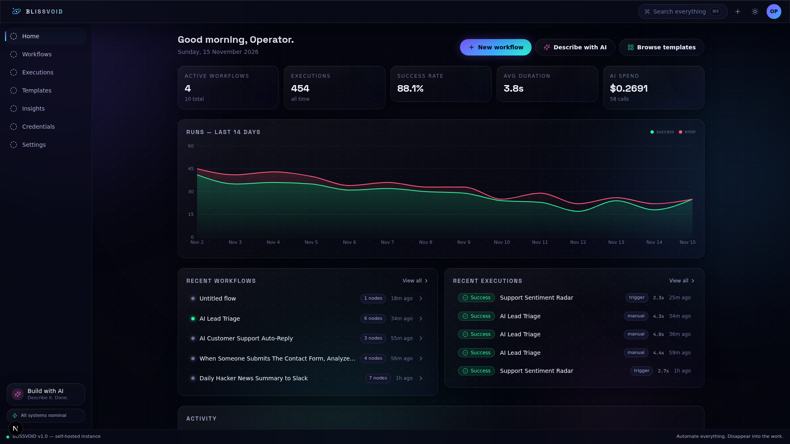
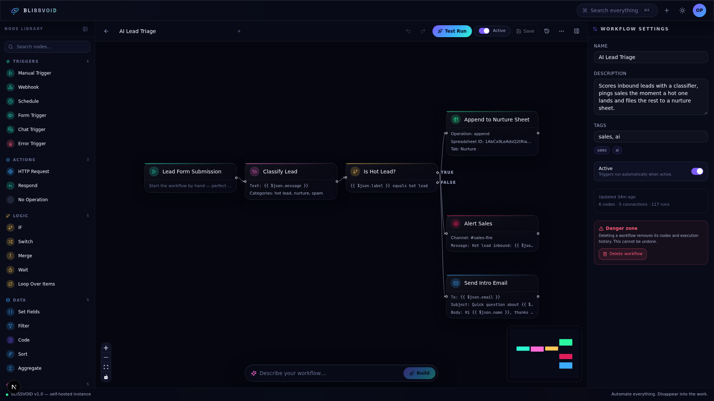
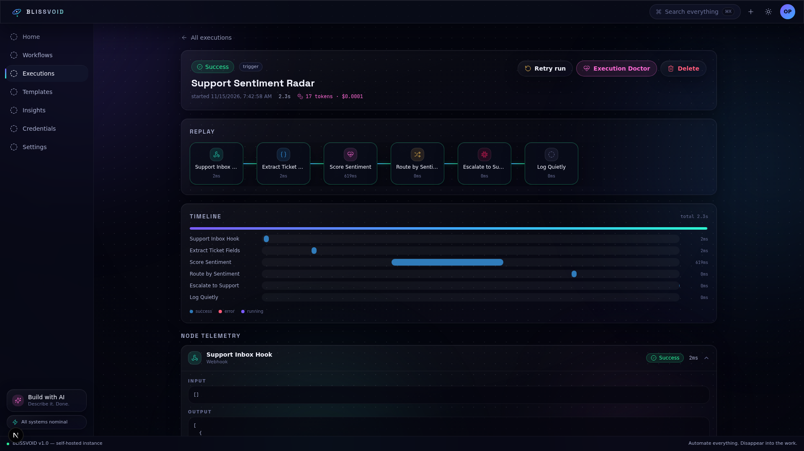

# BLISSVOID

**Automate everything. Disappear into the work.**

A self-hostable, AI-native workflow automation platform — the category of n8n, Zapier and Make, reimagined as a product from 2060. Deep cosmic darkness, luminous Bliss gradients (violet #7C5CFF → electric blue #3DA9FF → aqua #2CF5D0), glassmorphism surfaces, spring-based motion.

| Landing | Dashboard |
| :---: | :---: |
|  |  |

| Canvas editor | Execution timeline |
| :---: | :---: |
|  |  |

---

## What's inside

### The "Void & Bliss" experience
- **Landing** — animated orbit logo, gradient hero, a living workflow demo strip with travelling light pulses
- **Dashboard** — greeting, quick actions, live stats, 14-day runs chart, recent workflows/executions, activity feed
- **Workflows** — grid & table views, folders, tag filters, active toggles, one-click run/duplicate/delete
- **Canvas editor** (the hero screen) — React Flow canvas with custom glass nodes, drag-from-palette, Tab quick-add, undo/redo, copy/paste, minimap, alignment to grid, per-node inspector (Parameters / Input / Output / Settings / Notes), expression previews (`{{ $json.field }}`), data pinning, live execution streaming with per-node status pulses, item counts on nodes, execution console, and an on-canvas AI prompt bar
- **Executions** — live-updating list with filters, detail view with replay strip, Gantt timeline, per-node telemetry (input/output JSON), retry, and the **Execution Doctor** (AI diagnosis: what happened / why / how to fix)
- **Credentials vault** — AES-256-GCM encryption at rest, masked previews, test-connection, 12 credential types
- **Template gallery** — 14 curated starter flows with one-click "Use template"
- **Insights** — runs per day, status donut, durations by workflow, top-failing workflows, AI spend
- **Settings** — appearance (dark/light), workspace, BYOK AI providers, variables, data export
- **Command palette** — Ctrl/Cmd+K to jump anywhere, run templates, build with AI, switch theme

### AI-native superpowers (real LLM calls, backend only via z-ai-web-dev-sdk)
- **AI Workflow Builder** — describe a workflow in plain English; the architect model drafts nodes/connections/parameters, with a deterministic keyword-planner fallback
- **AI nodes** — Chat Model, Summarizer, Text Classifier (with confidence), Sentiment, Agent — executed for real inside the engine
- **AI Node Assistant** — "Ask AI" in any node writes expressions/code and explains errors
- **Execution Doctor** — diagnoses failed runs from node input/output/error context

### Execution engine (src/lib/engine)
- Items-based data model (`{ json, binary? }[]`) like n8n
- Directed-graph traversal with IF/Switch handle routing, merge, zero-item skip
- Per-node retries with exponential backoff, timeouts, continue-on-fail, error routes
- Durable execution state persisted per node (NodeRun rows) — the UI polls live progress
- Expression engine: `{{ $json.x }}`, `{{ $node["Name"].json }}`, `{{ $now }}`, `{{ $input }}`, `{{ $vars }}`, JS expressions, 15 operators
- **HTTP Request node does real fetches**; integration nodes (Slack, Email, Notion, Sheets, Telegram, Discord, GitHub, Stripe) deliver realistic simulated outputs marked `_simulated`
- Sandboxed Code node (guarded `new Function` scope, 5s timeout, blocked dangerous globals)
- 32 node types across Triggers / Actions / Logic / Data / AI / Integrations

### Stack
- Next.js 16 (App Router) + TypeScript strict
- Tailwind CSS 4 + shadcn/ui + Radix + Lucide icons + Framer Motion springs
- @xyflow/react (React Flow v12) canvas
- Zustand (app/editor state) + TanStack Query (server state)
- Prisma + SQLite (Workflows, Executions, NodeRuns, Credentials, Templates, Variables, AiUsage, ActivityLog)
- z-ai-web-dev-sdk (backend only) for all AI features
- recharts for analytics, sonner for toasts, cmdk for the command palette

## Quick start

```bash
cp .env.example .env  # configure the SQLite database path
bun install            # install dependencies
bun run db:push        # create the SQLite schema (db/custom.db)
bun run dev            # start on http://localhost:3000
```

On first load the app seeds itself: 6 demo workflows, 14 templates, 4 credentials, ~450 executions of history (14 days), AI usage and an activity feed — so every dashboard, chart and replay feels alive immediately.

Useful scripts:

```bash
bun run lint         # ESLint (zero warnings)
bun run db:push      # sync prisma schema
```

## Project map

```
src/
  app/
    page.tsx                 # single-page app shell (landing <-> app, sidebar, command palette, AI builder)
    layout.tsx               # fonts (Inter / JetBrains Mono / Space Grotesk) + metadata
    globals.css              # Void & Bliss design tokens, glass system, aurora, react-flow theme
    api/                     # 21 REST routes (workflows, executions, credentials, templates,
                             #   stats, ai/*, seed, variables, hooks/[path])
  lib/
    blissvoid/
      types.ts               # domain types shared by engine + UI
      node-catalog.ts        # 32 node definitions (params schema drive the inspector)
      api-client.ts          # typed fetch client
      store.ts               # zustand app state
      dto.ts / seed-data.ts  # mappers + demo seeder
    engine/
      engine.ts              # graph executor: wave traversal, retries, durability
      executors.ts           # per-node-type execution (incl. real HTTP + AI)
      expression.ts          # {{ }} expression engine
      crypto.ts              # AES-256-GCM credential vault
  components/
    blissvoid/
      logo.tsx / aurora.tsx / shared.tsx
      command-menu.tsx       # Ctrl/Cmd+K palette
      ai-builder.tsx         # global AI workflow builder dialog
      editor/                # canvas editor (editor, bliss-node, palette, inspector,
                             #   param-controls, run-panel, code-editor, icon-map)
      views/                 # landing, dashboard, workflows, executions, credentials,
                             #   templates, insights, settings
prisma/schema.prisma         # SQLite schema
```

## Notes & honest trade-offs

- **Simulated integrations**: Slack/Email/Notion/Sheets/etc. nodes produce realistic outputs marked `_simulated` — no third-party credentials are required for the demo. HTTP Request and all AI nodes are real.
- **Webhooks are live**: `POST /api/hooks/support-inbox` really starts an execution (the Support Sentiment Radar workflow ships with this hook).
- **Sandbox**: the Code node blocks `require`, `process`, `import`, `eval`, `Function` and uses a 5s timeout — a pragmatic dev sandbox, not a hardened VM.
- **Single-user demo instance**: auth/multiplayer is out of scope for this build; the platform targets solo founders first.
- **Dark is the default theme**; the light "Lavender" theme is fully usable via the theme toggle.
- If you change `src/app/globals.css`, delete the `.next` folder and restart the dev server — Turbopack's dev cache can serve a stale stylesheet.

---

Built in the void. BLISSVOID v1.0 — self-hosted instance.
